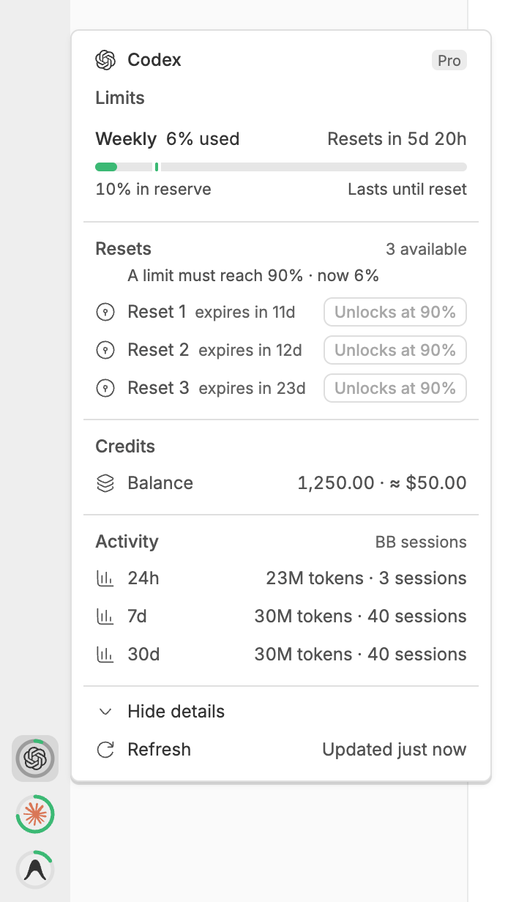
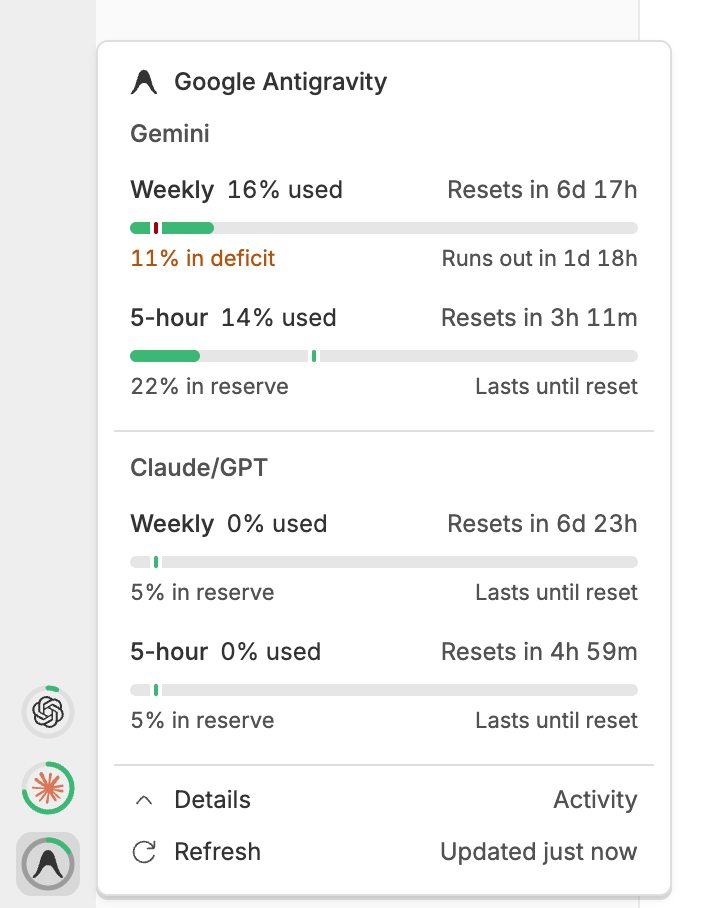
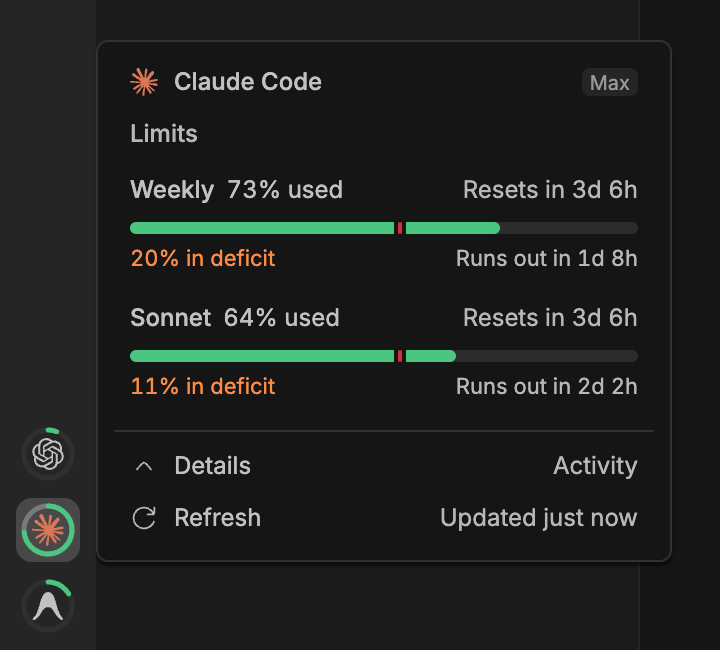

> [!IMPORTANT]
> **This repository has moved to [waiclay-349687/bb-plugins](https://github.com/waiclay-349687/bb-plugins/tree/main/plugins/usage-rings) and is archived (read-only).** New releases, issues and pull requests live there, in `plugins/usage-rings`. Install from the monorepo:
>
> ```sh
> bb plugin install git:https://github.com/waiclay-349687/bb-plugins.git --plugin usage-rings --yes
> ```
>
> Installed from a local clone of this repository? Clone bb-plugins and run `bb plugin install "path:$PWD" --plugin usage-rings --yes` in its root. bb moves the plugin to the new folder and keeps its settings.

# Usage Rings for bb

> **English** | [简体中文](README.zh-CN.md)

**See every agent's plan limit at a glance.** One ring per provider sits at the bottom of bb's sidebar rail; hover it to see how much is used, when it resets, and whether you are on pace to make it.

<table>
  <tr>
    <td width="50%"></td>
    <td width="50%"><br><br></td>
  </tr>
</table>

## Highlights

- **Every provider, one source of truth**: reads all sources of bb's usage protocol (`provider-usage.v1`), the same ones bb's own Provider usage card reads: built-in Codex, Claude Code and ACP collectors, plus any usage plugin you install.
- **Antigravity included**: adds an Antigravity source that runs the local `agy` CLI's built-in `/usage` command. Zero turns, zero tokens, no login files read. It shows Gemini and Claude/GPT five-hour and weekly windows and also appears in bb's own usage card.
- **Rings you can read from across the room**: the ring length is the tightest limit's share used. Green, amber from 75%, red from 90% (both adjustable). A used-up limit fills the ring in red; a failed refresh greys it and adds a red dot while the last reading stays.
- **Pace, not just percentages**: every window gets a full-width bar with an even-pace marker, how far in reserve or deficit you are, and when it runs out at your current rate.
- **Codex extras**: banked resets with a guarded two-step **Use**, and your credit balance in dollars.
- **Activity from bb itself**: tokens and sessions for 24 hours, 7 days and 30 days, counted from the usage bb already records.


## The hover card

Hover a ring and its card opens beside it, styled like bb's own thread context card, bottom edge level with the ring. All rings share one card: move to another ring and the card slides there, eases to the new height, and swaps its contents with a short fade.

- **Limits** (always shown): each window's share used, a bar with an even-pace marker, time to reset, reserve or deficit, and when it runs out. Windows named "Group · Window" (Antigravity's Gemini and Claude/GPT) get a section per group.
- **Details** (closed by default, remembered for every card) opens **above** its toggle row, so the toggle stays under your pointer while the card grows upward:
  - **Resets** (Codex): banked resets with their expiry, each with a button. Until a limit reaches the unlock threshold (90% by default) the button is greyed out and reads "Unlocks at 90%"; then it becomes a two-step **Use**.
  - **Credits** (Codex): the balance and its dollar value. Resets and credits come from the Codex CLI's `app-server`; no login files are read.
  - **Activity**: tokens and sessions for 24 h, 7 d and 30 d. Sessions run outside bb are not counted.
- **Refresh**: re-reads every source and shows when they were last read.

Clicking a ring does nothing. With the keyboard, Enter opens the card and moves focus into it, and Escape returns to the ring. On touch screens a tap opens and closes it. The plugin's settings page shows the same cards for every provider.

<details>
<summary><b>How pace is calculated</b></summary>

For a window of known length (five-hour, daily, weekly), following Synara:

| Quantity | Rule |
| --- | --- |
| Elapsed share | time since the window opened ÷ window length, counted as at least 5% so early use does not read as an emergency |
| Reserve / deficit | used % − elapsed share |
| Projected use | used % ÷ elapsed share: ≤ 80% **ahead**, ≤ 100% **on track**, otherwise **behind** |
| Runs out in | shown when you are behind and the projection runs out before the reset |
| On pace | a reserve or deficit that rounds to 0% always reads "On pace" and counts as on track: no warning colour, no "runs out in" |

</details>

<details>
<summary><b>Why Use reset can't spend a reset twice</b></summary>

| Guard | What it does |
| --- | --- |
| Two-step confirm | The first click arms the button for four seconds; the second runs it. |
| Idempotency key | Each confirmed attempt gets a key stored *before* the request is sent. A result that never arrives can only be retried as the same attempt, never spent twice. |
| Server re-check | The server re-reads usage first and refuses if the account changed or no limit is at 90% or more. |
| 90% guard | The plugin's own rule (borrowed from Synara; adjustable as `resetUnlockThreshold`), so a reset is not wasted while plenty is left. Codex's own client lets you try any time and answers "does not need a reset". |

</details>

## Settings

Everything below is adjustable on the plugin's settings page (**Preferences**, collapsible, with **Reset to defaults**) or from the CLI. Out-of-range values are clamped, and red never starts below amber.

| Key | Default | Range | What it does |
| --- | --- | --- | --- |
| `language` | `auto` | `auto` / `en` / `zh` | Interface language (see below) |
| `warnThreshold` | `75` | 40–95 | Rings and bars turn amber at this % used |
| `dangerThreshold` | `90` | 50–100, ≥ amber | Rings and bars turn red at this % used |
| `resetUnlockThreshold` | `90` | 50–100 | A banked Codex reset can be used once a limit reaches this % used; the server re-checks it before every reset |
| `antigravityEnabled` | `true` | on / off | Offer the built-in Antigravity source (`agy /usage`) |
| `refreshIntervalMinutes` | `5` | 1–60 | How often usage is re-read in the background |
| `defaultDetailsOpen` | `false` | on / off | Whether the hover card starts with Details open |
| `hiddenProviders` | empty | provider ids, comma-separated | Rings hidden from the sidebar (the settings page still shows them) |

```sh
bb plugin config usage-rings                              # show all settings
bb plugin config usage-rings set warnThreshold 60
bb plugin config usage-rings set hiddenProviders codex
bb plugin config usage-rings unset warnThreshold          # back to the default
```

## Language

The plugin speaks English and Simplified Chinese, and never mixes the two: in English mode no Chinese appears anywhere in the rings, cards or settings page, and in Chinese mode every label, status, duration and window name is Chinese (only brand, model and plan names such as Codex, Gemini or Pro stay as they are).

| Setting | Behaviour |
| --- | --- |
| `auto` (default) | Follows bb's language: `zh*` → Simplified Chinese, anything else → English |
| `en` | Always English |
| `zh` | Always Simplified Chinese |

Switch it on the plugin's settings page (**Language**: Auto / English / 简体中文; takes effect at once) or from the CLI:

```sh
bb plugin config usage-rings set language zh   # or en, auto
```

## Design

Colours, type sizes, radii and surfaces come from bb's theme and component library; motion uses bb's durations and curves (see `lib/motion.ts`). The card enters and leaves like bb's popovers, opens 100 ms after the pointer arrives and closes 200 ms after it leaves. Nothing loops in the sidebar, and with "reduce motion" on only short fades remain.

## Requirements and limits

- Rings show with the **Rail** navigation (bb's default). Top list and compact layouts have no rail; the settings page still works.
- The rings mount into bb's rail element (`nav[data-sidebar-navigation-placement="rail"]`). If a bb update changes it, the rings stop showing and nothing else breaks.
- Codex resets and credits need the `codex` CLI on the bb server's PATH (or `CODEX_BIN`).
- The Antigravity ring needs a provider with `antigravity` in its id registered in bb, and the `agy` CLI signed in (looked up in `AGY_BIN`, `~/.local/bin`, `/opt/homebrew/bin`, `/usr/local/bin`, then PATH).

## Install

Clone this repository, then install it into bb from its folder:

```sh
git clone https://github.com/waiclay-349687/bb-plugin-usage-rings.git
cd bb-plugin-usage-rings
npm install --include=dev
bb plugin build .
bb plugin install "path:$PWD" --yes
```

## Develop

```sh
npm run check            # typecheck + tests + bb plugin build
bb plugin reload usage-rings
```

`lib/token-totals.ts` is adapted from Usage Bar (MIT); see `THIRD_PARTY_NOTICES.md`.

## Related BB Plugins

- [bb-plugin-worktree-lineage](https://github.com/waiclay-349687/bb-plugin-worktree-lineage): Worktree & branch-lineage sidebar thread list with smooth motion, Settled shelf, attention-jump shortcuts, and hover briefings.
- [bb-plugin-session-cockpit](https://github.com/waiclay-349687/bb-plugin-session-cockpit): Top-right thread cockpit with Progress, Usage & live Context breakdown, real-time Context files tracking, Servers, Scripts, and Connectors.
- [bb-plugin-usage-rings](https://github.com/waiclay-349687/bb-plugin-usage-rings) (this plugin): Sidebar usage rings with pace tracking across providers, including Antigravity.

## License

MIT, see [LICENSE](LICENSE).
