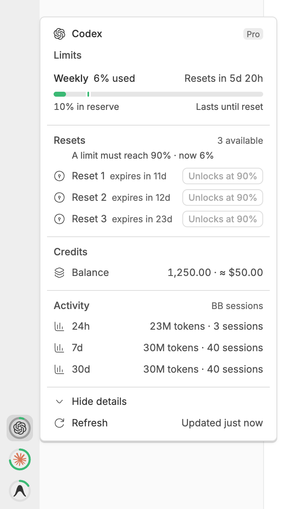
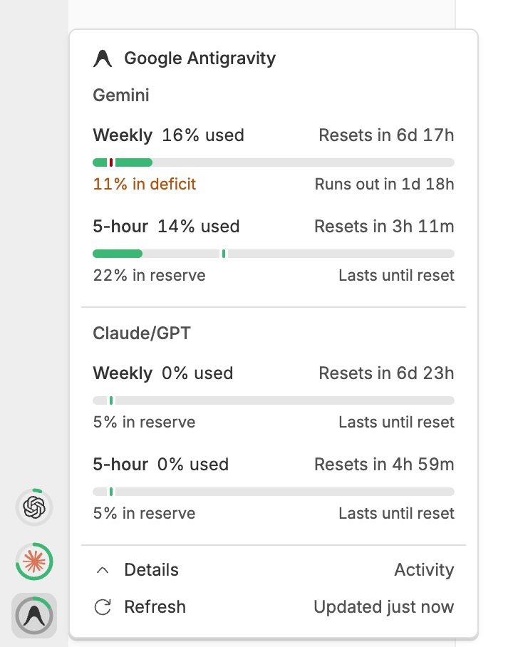
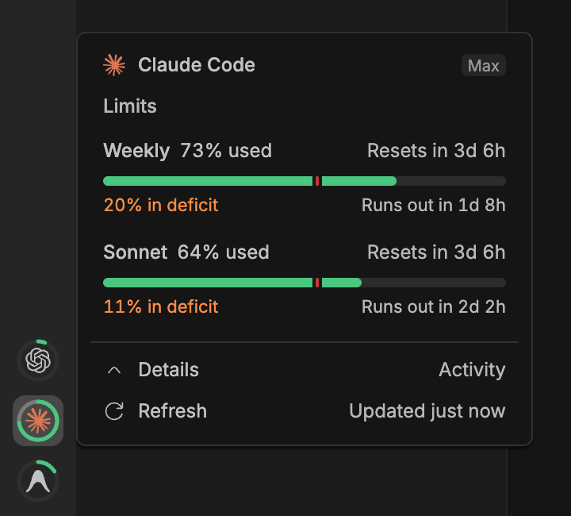

# Usage Rings（bb 额度圆环插件）

> [English](README.md) | **简体中文**

**每个 agent 的套餐额度，一眼看清。** bb 侧边栏左下角，每个提供方一个圆环；鼠标悬停就能看到用了多少、什么时候重置、照现在的速度够不够用。

<table>
  <tr>
    <td width="50%"></td>
    <td width="50%"><br><br></td>
  </tr>
</table>

## 亮点

- **所有提供方，同一个数据源**：读取 bb 用量协议（`provider-usage.v1`）的全部来源，和 bb 自带的 Provider usage 卡片读的是同一批：内置的 Codex、Claude Code、ACP 采集器，以及你装的任何用量插件。
- **自带 Antigravity**：插件额外提供一个 Antigravity 来源，调用本机 `agy` 命令行自带的 `/usage`。不发起对话、不消耗 token，也不读任何登录文件。它显示 Gemini 与 Claude/GPT 的 5 小时和每周额度，bb 自带的用量卡片里也能看到。
- **圆环远远一看就懂**：环长是最紧那个额度的已用比例。绿色正常，用到 75% 变琥珀，90% 变红（两个阈值都能调）。额度用完就是整圈红；刷新失败时圆环变灰并多一个红点，同时保留上次读数。
- **不只是百分比，还有配速**：每个窗口一根整行宽的进度条，上面的刻度标出"匀速应该用到哪"，下面写着还有多少余量或超了多少，以及照现在的速度什么时候用完。
- **Codex 额外信息**：攒下的重置次数（带保护的两步 **Use**），以及 Credits 余额折合多少美元。
- **用量统计来自 bb 本身**：24 小时、7 天、30 天的 token 数和会话数，按 bb 已经记录的用量计算。


## 悬浮卡片

悬停圆环，卡片就出现在它旁边，样式照 bb 会话页的上下文卡片，底边和圆环对齐。所有圆环共用一张卡片：移到另一个圆环时，卡片滑过去、高度平滑伸缩，内容淡出再淡入。

- **Limits**（始终显示）：每个窗口的已用比例、带匀速刻度的进度条、重置倒计时、余量或超额，以及预计用完时间。名字形如"分组 · 窗口"的额度（比如 Antigravity 的 Gemini、Claude/GPT）按分组各占一节。
- **Details**（默认收起，所有卡片共用同一个开关状态）从开关行的**上方**展开，卡片往上长，刚点的开关始终留在指针下面：
  - **Resets**（Codex）：攒下的重置及各自的过期时间，每个都有按钮。任一额度用到解锁阈值（默认 90%）之前，按钮是灰的，写着解锁条件；之后变成两步确认的**使用**按钮。
  - **Credits**（Codex）：余额和折合的美元。重置和 Credits 都通过 Codex 命令行的 `app-server` 读取，不读登录文件。
  - **Activity**：24 小时、7 天、30 天的 token 数和会话数。不在 bb 里跑的会话不计入。
- **Refresh**：重新读取所有来源，并显示上次读取的时间。

点击圆环不会做任何事。用键盘时，按 Enter 打开卡片并把焦点移进去，按 Esc 回到圆环。触屏设备点一下开、再点一下关。插件的设置页里也能看到每个提供方的同款卡片。

<details>
<summary><b>配速是怎么算的</b></summary>

对时长固定的窗口（5 小时、每天、每周），算法沿用 Synara：

| 指标 | 规则 |
| --- | --- |
| 已过时间占比 | 窗口开始至今的时间 ÷ 窗口时长，最少按 5% 算，免得刚开窗口时稍微用一点就显得很紧急 |
| 余量 / 超额 | 已用 % − 已过时间占比 |
| 预计用量 | 已用 % ÷ 已过时间占比：≤ 80% 为**宽裕**，≤ 100% 为**正常**，否则为**偏快** |
| 预计用完 | 偏快、且按这个速度会在重置前用完时才显示 |
| On pace | 余量或超额四舍五入为 0% 时一律写 "On pace"，按正常处理：不标警示色，也不显示预计用完 |

</details>

<details>
<summary><b>为什么 Use reset 不会把一次重置用两遍</b></summary>

| 保护 | 作用 |
| --- | --- |
| 两步确认 | 第一次点击后按钮进入 4 秒确认状态，再点一次才真正执行。 |
| 幂等键 | 每次确认都会生成一个键，并在发请求**之前**存好。如果结果没能返回，只能用同一个键重试同一次操作，绝不会扣两次。 |
| 服务端复核 | 服务端执行前会重新读取用量；如果账号变了，或者没有任何额度到 90%，就拒绝执行。 |
| 90% 门槛 | 这是插件自己的规则（借鉴 Synara，可通过 `resetUnlockThreshold` 调整），避免额度还很充裕时浪费一次重置。Codex 自己的客户端随时都能试，不需要时会回复 "does not need a reset"。 |

</details>

## 设置

下面每一项都能在插件设置页的**偏好设置**（可折叠，带**恢复默认**）里调，也能用命令行改。超出范围的值会被夹回范围内，红色阈值不会低于橙色阈值。

| 设置项 | 默认 | 范围 | 作用 |
| --- | --- | --- | --- |
| `language` | `auto` | `auto` / `en` / `zh` | 界面语言（见下节） |
| `warnThreshold` | `75` | 40–95 | 圆环和进度条用到这个百分比变橙色 |
| `dangerThreshold` | `90` | 50–100，且不低于橙色阈值 | 用到这个百分比变红色 |
| `resetUnlockThreshold` | `90` | 50–100 | 任一额度用到这个百分比，Codex 的重置按钮才解锁；每次重置前服务端都会按它再核对一次 |
| `antigravityEnabled` | `true` | 开 / 关 | 是否启用内置的 Antigravity 采集源（`agy /usage`） |
| `refreshIntervalMinutes` | `5` | 1–60 | 后台自动重读用量的间隔（分钟） |
| `defaultDetailsOpen` | `false` | 开 / 关 | 悬浮卡片默认是否展开详情 |
| `hiddenProviders` | 空 | 提供方 id，逗号分隔 | 不在侧边栏显示的圆环（设置页照常显示） |

```sh
bb plugin config usage-rings                              # 查看全部设置
bb plugin config usage-rings set warnThreshold 60
bb plugin config usage-rings set hiddenProviders codex
bb plugin config usage-rings unset warnThreshold          # 恢复默认
```

## 语言

插件支持英文和简体中文，并且绝不混用：英文模式下，圆环、卡片和设置页里一个汉字都不会出现；中文模式下，所有标签、状态、时长和窗口名都是中文（只有 Codex、Gemini、Pro 这类品牌、模型和套餐名保持原样）。

| 设置 | 效果 |
| --- | --- |
| `auto`（默认） | 跟随 bb 的界面语言：`zh` 开头用简体中文，其余用英文 |
| `en` | 始终英文 |
| `zh` | 始终简体中文 |

可以在插件设置页切换（**语言**：自动 / English / 简体中文，点了立即生效），也可以用命令行：

```sh
bb plugin config usage-rings set language zh   # 或 en、auto
```

## 设计

颜色、字号、圆角和底色全部取自 bb 的主题与组件库；动效沿用 bb 的时长和曲线（见 `lib/motion.ts`）。卡片的进出场和 bb 的弹出层一致：指针停留 100 ms 后打开，离开 200 ms 后收起。侧边栏里没有循环动画；开启"减少动态效果"后只保留极短的淡入淡出。

## 使用前提与限制

- 圆环只在 **Rail** 导航（bb 默认）下显示。Top list 和窄屏布局没有 rail，但设置页照常可用。
- 圆环挂在 bb 的 rail 元素（`nav[data-sidebar-navigation-placement="rail"]`）上。如果 bb 更新改了它，圆环会不再显示，其他功能不受影响。
- Codex 的重置和 Credits 需要 bb 服务所在机器的 PATH 里有 `codex` 命令行（或设置 `CODEX_BIN`）。
- Antigravity 圆环需要 bb 里注册了 id 含 `antigravity` 的提供方，并且 `agy` 命令行已登录（依次在 `AGY_BIN`、`~/.local/bin`、`/opt/homebrew/bin`、`/usr/local/bin`、PATH 中查找）。

## 安装

克隆本仓库，然后在仓库目录里安装到 bb：

```sh
git clone https://github.com/waiclay-349687/bb-plugin-usage-rings.git
cd bb-plugin-usage-rings
npm install --include=dev
bb plugin build .
bb plugin install "path:$PWD" --yes
```

## 开发

```sh
npm run check            # 类型检查 + 测试 + bb plugin build
bb plugin reload usage-rings
```

`lib/token-totals.ts` 改编自 Usage Bar（MIT），见 `THIRD_PARTY_NOTICES.md`。

## 同系列 BB 插件

- [bb-plugin-worktree-lineage](https://github.com/waiclay-349687/bb-plugin-worktree-lineage)：左侧线程列表，按对话 / 分支树双视图展示，带 Settled 软收起、待办快跳、悬停全程速览与丝滑动效。
- [bb-plugin-session-cockpit](https://github.com/waiclay-349687/bb-plugin-session-cockpit)：右上角会话驾驶舱，展示阶段进度、实时上下文占比与文件读取统计、缓存、本地服务与项目脚本。
- [bb-plugin-usage-rings](https://github.com/waiclay-349687/bb-plugin-usage-rings)（本插件）：侧边栏额度圆环，跨提供方追踪配速，包括 Antigravity。

## License

MIT, see [LICENSE](LICENSE).
